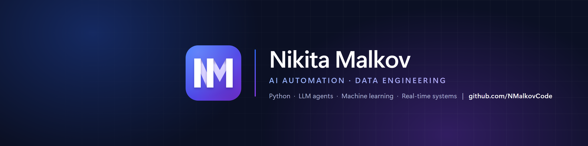

### Hi, I'm Nikita 👋

I build software that removes manual work, then make sure it holds up in real use. At Ecologic SIPs I replaced a hand-typed bill of quantities with a Python + Claude agent workflow that cut processing time by **90%**. I have a BEng in Aeronautical & Astronautical Engineering (2:1) from the University of Southampton.

**Looking for:** AI engineering, forward-deployed / solutions engineering and data engineering roles · UK Graduate visa to Oct 2028 · open to relocating to the UAE.

### Projects

| Project | What it does |
|---|---|
| [**AI Daily Job Search**](https://github.com/NMalkovCode/daily-job-search) | Claude agent pipeline: collects jobs daily from LinkedIn and 40+ job-board APIs, ranks them and drafts validated cover letters. Windows app, 121 tests. |
| [**HR Candidate Screening**](https://github.com/NMalkovCode/hr-application-filtering-system) | Explainable LLM screening app on the Anthropic API: HR-approved filters, quoted evidence, code-computed scores, prompt-injection safeguards. 187 tests. |
| [**Yearly Report Analytics**](https://github.com/NMalkovCode/company-yearly-report-analytics) | ML risk model trained on 25,432 SEC filings; calibrated LightGBM beats the momentum baseline on five outcomes in a walk-forward backtest, with SHAP reasons. |
| [**Wind Tunnel IIoT Monitor**](https://github.com/NMalkovCode/wind-tunnel-iiot-monitor) | Final-year project: real-time Raspberry Pi pressure monitoring over MQTT (<15 ms latency), commissioned in the R.J. Mitchell Wind Tunnel. |
| [**Daily Planner**](https://github.com/NMalkovCode/daily-planner) | Windows desktop planner (Tauri, React, SQLite) with multi-day projects, reminders and a tray summary. 65 tests. |

### Tech

Python · SQL · Claude / Anthropic API · LightGBM · scikit-learn · Pandas · DuckDB · PySide6 · MQTT · pytest · Power BI · TypeScript · React

### Contact

[LinkedIn](https://www.linkedin.com/in/nikitamalkov13/) · [nikita.malkov1301@gmail.com](mailto:nikita.malkov1301@gmail.com) · English · French · Russian
